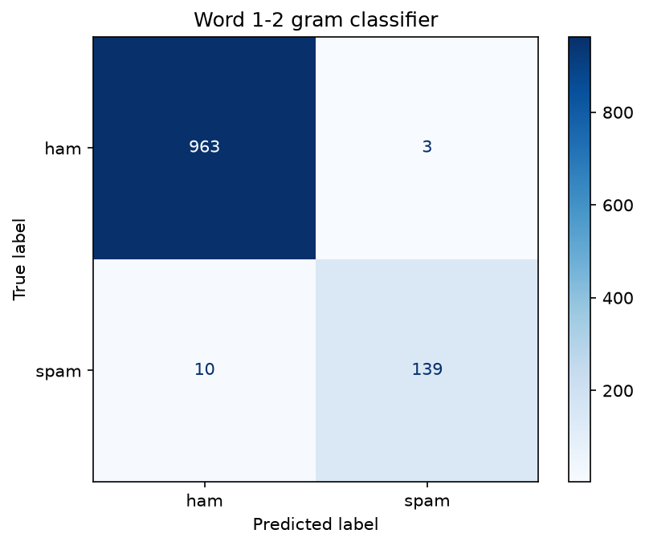
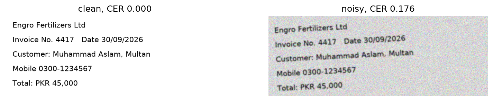

# Project 2: Deep Learning Applications

Introduction to Applied AI | BS 8th Semester | Department of Electronics
Author: Muhammad Raheel Ijaz

## Project 2, Week 5: Scene Classification with Transfer Learning

- Dataset: Intel Image Classification, 6 classes, 14,034 train / 3,000 test (split 11,929 train / 2,105 val / 3,000 test)
- Model: ResNet-18 pretrained on ImageNet, trained on CPU
- Feature extraction (3,078 trainable parameters): val accuracy 0.907
- Fine-tuning layer4 (about 8.4M trainable): val accuracy 0.928 (+2.09 points)
- Test accuracy (used once): 0.929; weakest class: glacier (recall 0.863), confused with mountain (65 images)
- Most instructive error: a black-and-white alley between tall stone buildings, labelled "buildings", was predicted "street" with probability 1.00, because the photo is taken from street level, so the two classes overlap and confidence is not correctness.
- Next: my own domain in Week 6, crop disease classification from leaf images (see the Week 6 section below)

### Results at a glance (Week 5)

| Phase | Epochs | Trainable params | Best val accuracy |
|---|---|---|---|
| Feature extraction (frozen body, new head) | 3 | 3,078 | 0.907 |
| Fine-tuning (layer4 + head, lr 1e-4 / 1e-3) | 3 | 8,396,806 | 0.928 |

Test accuracy 0.929 (2,787 / 3,000). The two biggest confusions are glacier vs mountain (65 + 37 errors) and street vs buildings (43 + 19 errors); together they are 77% of all 213 errors. Training showed mild overfitting at epoch 6 (training loss falling, validation loss rising), so the best epoch (epoch 5) was kept.

---

## Project 2, Week 6: Crop disease classification with ResNet-18 (PlantVillage)

**Who benefits:** farmers and agricultural extension workers. **Why it matters:** an undetected leaf disease spreads and cuts yield; a photo-based early warning lets the farmer treat it before it spreads.

**Dataset:** PlantVillage (Hughes and Salathe), Kaggle copy [`abdallahalidev/plantvillage-dataset`](https://www.kaggle.com/datasets/abdallahalidev/plantvillage-dataset), `color/` folder; 54,304 images, 38 classes (12 healthy, 26 diseased; 14 crop species); labels assigned by the dataset authors (expert-diagnosed leaves). Licence: [CC BY-NC-SA 4.0](https://creativecommons.org/licenses/by-nc-sa/4.0/) (non-commercial use with attribution and share-alike). All images are 256 x 256 RGB. This run uses a stratified subsample of **4,372 images** (3,035 train / 729 val / 608 test) so that training is feasible on a CPU.

**Data audit:** imbalance ratio 36.2 on the full dataset (Orange Huanglongbing 5,507 vs Potato healthy 152) and 14.7 in the working set; exact duplicates 42 files in 21 sets (same-class copies, 0 overlaps between splits); test images with a near-duplicate in train 0 (threshold 0.10; closest pair distance 0.249). The file names carry no leaf id, so groups were built from image similarity: 4,372 groups for 4,372 images (1.00 per group), 0 shared groups between train, val and test. Pairs at distance 0.25 to 0.40 are clearly the same leaf photographed twice, so sibling shots exist that this check cannot group, and the test score may be optimistic.

**Imbalance handling:** class-weighted cross-entropy, w = N / (K x n_c); weights from 0.261 (Orange, 306 images) to 3.803 (e.g. Apple Cedar apple rust, n_c = 21: 3,035 / (38 x 21) = 3.803). Augmentation: random crop, rotation ±10°, brightness/contrast ±0.15, horizontal and vertical flips; no hue or saturation jitter.

**Training (ResNet-18, CPU, about 50 minutes in total):**

| Phase | Epochs | Trainable params | Best val macro-F1 | Time per epoch |
|---|---|---|---|---|
| 1: head only | 2 | 19,494 | 0.786 | about 9 min |
| 2: layer4 + head (lr 1e-4 / 1e-3) | 3 | 8,413,222 | 0.929 | about 11 min |

The best epoch was chosen by validation macro-F1 (not accuracy); fine-tuning added 14.3 points.

**Results (test set, used once):** macro-F1 **0.943**, accuracy 0.941 (608 images). Weakest class: Tomato Early blight (recall 0.667, 12 images), then Grape Black rot (0.692) and Tomato Bacterial spot (0.708). Biggest confusions: Grape Black rot to Esca (4), Tomato Septoria to Leaf Mold (3), Tomato Bacterial spot to Early blight (3) and to Septoria (3). Healthy-vs-diseased view (threshold 0.639 set on validation for recall >= 0.95): sensitivity 0.995, specificity 0.982, AUC about 1.000, target recall reached on test. PPV 0.993 at the test prevalence (0.722) but 0.862 at an assumed field prevalence of 10%: PPV = (0.995 x 0.1) / (0.995 x 0.1 + 0.018 x 0.9) = 0.0995 / 0.1157 = 0.86.

**Grad-CAM:** the model looks at the central leaf blade (lesions, mottling and veins), and the share of heat in the outer 10% border is only 0.16 (uniform would be 0.36). Shortcut risk: **suspected, not confirmed**. A classifier that sees only four 8 x 8 background corners (no leaf) reaches 0.438 validation accuracy against 0.026 chance and 0.102 for always predicting the biggest class, so the PlantVillage background carries class information (as reported by [Noyan 2022](https://arxiv.org/abs/2206.04374)). Follow-up: re-score on segmented or background-replaced images and on real field photos.

**Limitations:** PlantVillage is a lab-condition dataset (single leaf, plain table background, 14 crops); trained on an 8% subsample; sibling shots of the same leaf could not be grouped; several test classes have only 4 to 7 images; not validated on field photos. **Not for** unsupervised field diagnosis or spray decisions without an expert check.

### Responsibility questions
1. **Who could be harmed?** A farmer told "healthy" for a diseased crop loses harvest; one told "diseased" for a healthy crop wastes money and over-sprays; a wrong disease name (e.g. tomato Early blight vs Late blight vs Septoria) leads to the wrong treatment.
2. **Where was it not validated?** Field photos, other phones and lighting, other regions and seasons, leaves with two diseases, diseases outside the 38 classes; the background leaks the label, so 0.943 probably overstates field performance.
3. **Human role:** the model only proposes a diagnosis; a farmer or extension worker confirms it before any treatment, and an expert checks the tomato spot diseases.
4. **What would change my conclusions:** accuracy on real field photos, a large drop on background-removed images (shortcut confirmed), or a full-dataset leakage audit showing sibling shots across splits.

---

## Project 2, Week 7: Text and Multimodal AI (crop-disease domain)

**Goal:** give the Week 6 leaf-disease system the ability to read: every text component gets a number, and the image model and a farmer's note are combined into one privacy-masked, explainable JSON record.

- Text classifier: SMS Spam Collection (Kaggle, uciml), 5,572 texts, macro-F1 0.974 (word 1-2 grams) vs 0.982 (char 2-5 grams); spam precision/recall 0.979/0.933 (word) and 0.986/0.953 (char)
- Top positive / negative features: call, txt, free, text, reply, uk / my, me, ok, that, it, but
- NER on my domain (crop disease, 5 held-out sentences): out-of-the-box F1 0.562 -> with entity ruler 0.686 (provided six sentences: 0.533 -> 0.875)
- Regex fields extracted: lot code, plot number, field area, spray dose, CNIC, mobile, amount, date, email, invoice number; false positives tested: 6 negative tests, 11/11 tests pass
- OCR: CER raw 0.000 -> after correction rules 0.000 on the clean synthetic invoice; the three digit-confusion pairs went from 0.062 / 0.059 / 0.143 to 0.000 / 0.000 / 0.000
- Pipeline: Week 6 image model (ResNet-18, 38 PlantVillage classes) + text evidence -> JSON record (example below)
- Privacy: CNIC, phone, and email masked before logging and before any extraction (0 identifier digits found in the record)

### Results at a glance (Week 7)

| Component | Measured result |
|---|---|
| SMS spam, word 1-2 grams | macro-F1 0.974, spam precision 0.979, spam recall 0.933, 12,128 features |
| SMS spam, char 2-5 grams | macro-F1 0.982, spam precision 0.986, spam recall 0.953, 36,449 features |
| NER, provided 6 sentences | F1 0.533 -> 0.875 with 7 entity-ruler patterns |
| NER, my crop-disease sentences 1-5 (rules written here) | F1 0.4 -> 0.941 |
| NER, my crop-disease sentences 6-10 (held out) | F1 0.562 -> 0.686 |
| Regex | 11/11 tests pass (6 negative tests) |
| OCR (clean invoice) | CER 0.000 -> 0.000 |

### Key findings
- Character n-grams gave the higher macro-F1 on the same test split (0.982 vs 0.974) but needs about three times as many features (36,449 vs 12,128). Of the 13 word-model errors I judged 7 to be model errors, 5 ambiguous and 1 label error(s).
- Some top weights are shortcuts rather than meaning: "to" and "your" are ordinary words, "call" also appears in ham ("Waiting for your call." scored 0.853 spam), and "gt"/"lt" on the ham side are HTML-escape leftovers in the dataset.
- Out of the box spaCy labelled "Engro Fertilizers" as PERSON and did not detect "PKR 45,000" at all. Rules lifted the provided-set F1 from 0.533 to 0.875, but on held-out crop sentences only from 0.562 to 0.686, because name lists do not transfer to unseen names.
- Regex handles formats (plot, lot, dose, phone) that NER gets wrong; the first `plot` pattern also matched inside "subplot" until I added a word boundary and required spacing.
- OCR digit-repair rules fix letter-for-digit confusions only; they cannot repair missing or reordered text.
- Masking is done before extraction so identifiers can never reach the evidence fields; a leftover side effect is that the `[CNIC]` placeholder is tagged ORG by NER, which I judged harmless for the decision.




### Example case record (identifiers masked)

```json
{
  "image": "0051e5e8-d1c4-4a84-bf3a-a426cdad6285___RS_LB 4640.JPG",
  "image_evidence": {
    "top3": {
      "Potato___Late_blight": 0.835,
      "Tomato___Late_blight": 0.101,
      "Tomato___Early_blight": 0.059
    },
    "P(diseased)": 1.0
  },
  "note_masked": "Farmer in Sahiwal reports brown spots spreading on tomato leaves for 3 days. Field plot 12, 2.5 acres, sprayed 250 ml/acre. Visited by Dr. Saima Noreen at NARC Islamabad on 12/09/2026. Farmer mobile [PHONE], CNIC [CNIC].",
  "text_evidence": {
    "entities": [
      [
        "Sahiwal",
        "GPE"
      ],
      [
        "3 days",
        "DATE"
      ],
      [
        "12",
        "CARDINAL"
      ],
      [
        "2.5 acres",
        "QUANTITY"
      ],
      [
        "250 ml/acre",
        "QUANTITY"
      ],
      [
        "Saima Noreen",
        "PERSON"
      ],
      [
        "NARC",
        "ORG"
      ],
      [
        "12/09/2026",
        "DATE"
      ],
      [
        "CNIC",
        "ORG"
      ],
      [
        "CNIC",
        "ORG"
      ]
    ],
    "fields": {
      "date": [
        "12/09/2026"
      ],
      "plot": [
        "12"
      ],
      "area": [
        [
          "2.5",
          "acres"
        ]
      ],
      "dose": [
        [
          "250",
          "ml",
          "acre"
        ]
      ]
    },
    "urgent_terms": [
      "spreading",
      "brown spots",
      "spots"
    ]
  },
  "decision": "REFER",
  "reasons": [
    "image model: P(diseased) = 1.00",
    "note mentions: spreading, brown spots, spots"
  ],
  "image_and_note_agree": true,
  "disclaimer": "Decision support only; a qualified agronomist decides."
}
```

**Limitations:** the SMS data is English, from the 2000s and small (747 spam messages), so Roman Urdu and modern scams are poorly covered; my NER gold sets are tiny (6 provided + 10 own sentences, 17 held-out entities), so a gain of a few F1 points is partly noise and the entity rules only know the names I wrote; OCR was measured on one synthetic invoice, not on real scans; the case record combines image and note with simple rules (a probability threshold and keyword list), not a learned fusion; the example leaf is the first image of its class folder, not a verified held-out test image. **Not for** automated spray or treatment decisions.

### Responsibility questions (Week 7)
1. **Who could be harmed?** A farmer whose note mentions spreading disease but whose case is marked ROUTINE; anyone whose phone number or CNIC leaks into a log; a farmer misled by a wrong entity or amount extracted from a note.
2. **Where was it not validated?** Urdu and Roman Urdu notes, handwritten or phone-photographed invoices, other spaCy versions, and real advisory messages (the spam model was trained on SMS only).
3. **Human role:** the record is decision support; a qualified agronomist reviews every REFER and checks any case where the image and the note disagree (for example a different crop named in the note).
4. **What would change my conclusions:** a larger annotated set of real farmer notes, OCR error rates on real scans, or a leak found in the masked record.


### Files

| File | Purpose |
|---|---|
| `Week5_Transfer_Learning.ipynb` | Week 5 notebook (Parts 1 to 7, written answers, Check Your Understanding) |
| `Week6_Crop_Disease_Classification.ipynb` | Week 6 notebook (Parts 0 to 7, data audit, written answers, Check Your Understanding) |
| `Week7_Text_and_Multimodal.ipynb` | Week 7 notebook (Parts 0 to 7, written answers, Check Your Understanding) |
| `images/` | Week 5 figures, Week 6 figures (`w6_class_counts`, `w6_sample_grid`, `w6_closest_pairs`, `w6_learning_curve`, `w6_confusion_matrix`, `w6_gradcam`) and Week 7 figures (`w7_confusion_word`, `w7_ocr_images`, `invoice`, `invoice_noisy`) |
| `week7_case_record.json` | Example masked image + text case record from Week 7 |
| `models/resnet18_intel.pt` | Week 5 fine-tuned ResNet-18 weights (44.8 MB) |
| `models/week6_model.pt` | Week 6 fine-tuned ResNet-18 weights, 38 leaf classes (44.9 MB) |
| `requirements.txt` | Python packages (add `spacy` and `easyocr` for Week 7) |
| `data/` | Datasets (not uploaded to GitHub, see below) |

### How to run locally (Windows)

```
cd "D:\Documents-D\7th Semester\Intro to AI\Project-2\Deep Learning Applications"
python -m venv venv
venv\Scripts\activate
pip install torch torchvision
pip install numpy matplotlib pillow scikit-learn jupyter pandas scipy
pip install spacy easyocr
python -m spacy download en_core_web_sm
jupyter notebook
```

- **Week 5:** download https://www.kaggle.com/datasets/puneet6060/intel-image-classification , extract it into `data/`, open `Week5_Transfer_Learning.ipynb` and run the cells from top to bottom. With an NVIDIA GPU each epoch takes about a minute; on a CPU it takes 17 to 50 minutes.
- **Week 6:** download https://www.kaggle.com/datasets/abdallahalidev/plantvillage-dataset , extract it so that the folder `data/plantvillage dataset/color/` exists, open `Week6_Crop_Disease_Classification.ipynb` and run the cells from top to bottom. On a CPU each epoch takes about 9 to 11 minutes with the default 8% subsample (`SUBSAMPLE_FRAC = 0.08`).
- **Week 7:** download https://www.kaggle.com/datasets/uciml/sms-spam-collection-dataset , put `spam.csv` in `data/` (if it is missing the notebook downloads the same data from UCI), make sure `models/week6_model.pt` exists, open `Week7_Text_and_Multimodal.ipynb` and run the cells from top to bottom. The first run downloads about 100 MB of EasyOCR models, so keep the internet on.
